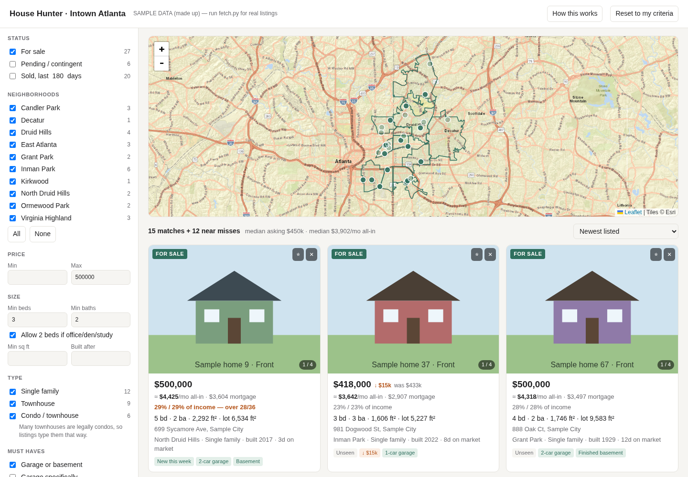
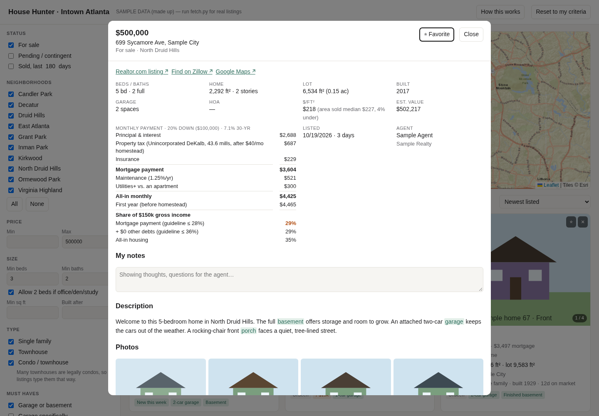

# House Hunter

A personal house-hunting dashboard. It pulls current listings and recent sales
for the neighborhoods you pick, then shows them in one HTML page where you can
filter by what you actually need and see what each home would really cost per
month.



**What it does that the big listing sites don't:**

- **Real neighborhood boundaries.** Homes are matched to official city or Census
  boundaries (or polygons you draw), not ZIP codes or "nearby".
- **Your criteria, including fuzzy ones.** For example "3 beds, or 2 plus an
  office", "garage or basement", and "decent yard (lot size, or a fenced yard
  mentioned)". Office, basement and yard are detected from the listing text.
- **Near misses.** Homes that fail only a soft requirement are shown, faded,
  with a note saying what they lack, instead of disappearing.
- **All-in monthly cost.** Principal and interest, property tax using local
  millage rates and homestead exemptions, insurance, HOA, maintenance and extra
  utilities, so you can compare it with rent.
- **Affordability.** Each home shows its share of your income against the
  28% / 36% guidelines.
- **Value check.** Each home's price per square foot is compared with recent
  sales in the same neighborhood, with links to those comparable sales.
- **Tracking.** New listings and price drops are flagged between refreshes.
  Favorites, hidden homes and notes are saved in your browser.
- **Browsing.** You can flip through photos on the cards, open a fullscreen
  photo viewer, and read a built-in "How this works" page that explains every
  calculation in plain English.



## Quick start

```sh
python -m venv .venv
.venv/bin/pip install -r requirements.txt
cp config.example.yaml config.yaml     # then edit it
.venv/bin/python fetch.py              # takes a few minutes
```

Open `index.html` in your browser. No server is needed. To refresh the data,
run `fetch.py` again and reload the page.

To try the page without fetching anything, run `.venv/bin/python fetch.py --sample`.
It fills the page with made-up homes inside your configured boundaries.

## Configuration

Everything location-specific or personal lives in `config.yaml`, which git
ignores. `config.example.yaml` is a fully commented example for a few intown
Atlanta neighborhoods. The sections are:

| Section | What it controls |
|---|---|
| `area.zips` | ZIP codes to search. Over-covering is fine, because results are clipped to the boundaries. |
| `area.boundaries` | Neighborhood polygons: any ArcGIS layer (most city GIS portals have one), US Census places (cities and CDPs, anywhere in the US), or your own GeoJSON. Each source names the tax area its homes belong to. |
| `search` | What gets downloaded: price caps, property types, how far back to fetch sold comps. |
| `criteria` | The page's starting filters. |
| `payment` | Rate, down payment, insurance, maintenance, income and debts, plus property tax rates and homestead savings per tax area. |
| `map` | Map tile provider. |

After editing only `criteria`, `payment` or `map`, run `fetch.py --config-only`
to update the page without re-downloading. Settings you change in the page's
sidebar are saved in your browser and override the config defaults. Use
"Reset payment assumptions" to go back to the config.

**Property tax outside Georgia:** set `assessment_ratio: 1.0` and express each
area's effective rate in mills (1.2% = 12 mills).

## Where the data comes from

Listings come from Realtor.com through the open-source
[HomeHarvest](https://github.com/ZacharyHampton/HomeHarvest) library.
Realtor.com and Zillow get agent listings from the same local MLS feeds, so
coverage is nearly identical. The main gap is for-sale-by-owner homes, which
appear only on Zillow. Zillow has no public API.

Boundaries come from public GIS services, such as city ArcGIS portals and the US
Census TIGERweb service.

## Important: personal use only

This is an unofficial tool. It is not affiliated with, endorsed by, or
sponsored by Realtor.com, Move Inc., Zillow, or any MLS.

- **Terms of use:** fetching listings uses Realtor.com's public website. Using it
  is subject to their terms of use, which you are responsible for following.
  Keep it to personal, non-commercial use at a modest pace.
- **Don't publish the data:** do not redistribute downloaded listing data or
  photos, or host it publicly. Listing content and photos are copyrighted by
  their owners. The `data/` folder is git-ignored for this reason.
- **Estimates only:** payment, tax and affordability numbers are rough estimates
  for comparison. They are not financial advice or a loan offer. Get real
  quotes from a lender and insurer, and check tax figures with your county.
- **Check the details:** features detected from listing text (office, basement,
  yard and so on) can be wrong. Confirm them with the listing agent.

## Files

```
fetch.py              downloads listings and boundaries, writes data/*.js
sample.py             fake listings for --sample
index.html            the whole app (open it directly)
config.example.yaml   documented example config
data/                 generated, git-ignored
```

## License

MIT. See [LICENSE](LICENSE).
